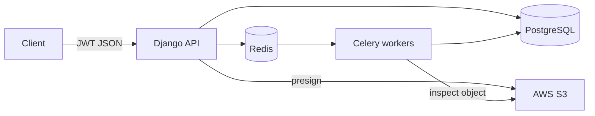
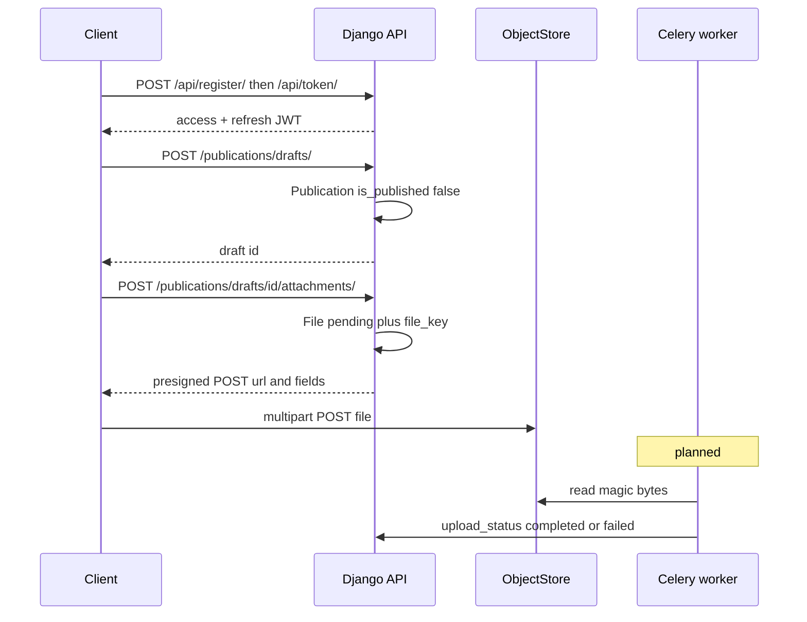
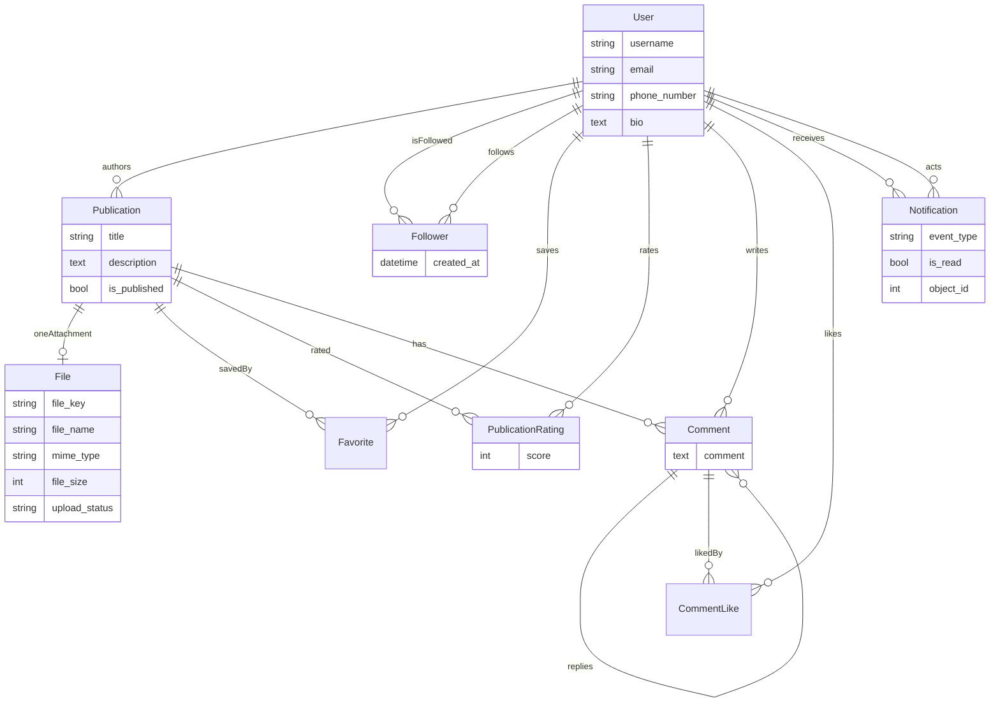

English | [Русский](README.ru.md)

# ReadKoom

**Koom** means *community* in Kyrgyz.

A backend API for students to share study materials — notes, slides, PDFs, images, audio — without dumping them into group chats.

> **Status:** In progress. Auth, drafts, and presigned uploads work. Workers, verification, social APIs, and Docker are in progress, not abandoned.

## Problem

University courses still share files through WhatsApp and Telegram groups: links expire, and nothing is searchable.

ReadKoom is meant to replace that pile of chats with a small social library. Files live in object storage (the cloud), not in someone’s phone. Registration and login via JWT. Anyone with an account can create a draft and upload. Metadata (title, description, author) makes materials findable later — follow, save, comment, and rate come next.

**Target users:** students and TAs who already live in group chats and need a durable place for lecture notes and homework files.

## Project status and roadmap

| Area | State |
|------|--------|
| Custom user, JWT (obtain / refresh / blacklist) | **Done** |
| Registration (hashed passwords, Django validators) | **Done** |
| Publication drafts (CRUD, author-scoped writes) | **Done** |
| One file per publication + presigned **upload** | **Done** |
| Filename MIME allowlist, size cap, short URL TTL | **Done** |
| Presigned **download** helper | **Done** (no HTTP route yet) |
| Follower / favorite / rating / comment / notification **models** | **Done** (schema only) |
| Magic-byte check (`python-magic`) | **In progress** (stub) |
| Celery + Redis (email, verification jobs) | **Planned** |
| Email verification, async password recovery | **Planned** |
| Publish feed, follow/unfollow APIs | **Planned** |
| Download API, comments / ratings / favorites APIs | **Planned** |
| Amazon S3 for object storage | **Done** |
| Docker Compose, tests, load numbers | **Planned** |
| Frontend | **Not started** |

## Architecture

**Target** (what the system is being built toward):



**Today in this repo:** Django + PostgreSQL + boto3 against Amazon S3. Redis, Celery, and Compose are not wired yet. The upload path below already matches how the API is written; worker inspection is still to land.

### Presigned upload flow

Bytes never pass through the API. Django stores metadata and a short-lived POST policy; the client puts the object straight in the bucket.



1. Authenticate (JWT).
2. Create a **draft** publication (unpublished parent).
3. Attach **one** file: API inserts `File` (`pending`) and returns `generate_presigned_post`.
4. Client uploads to the bucket under `publications/<user>/<uuid>`.
5. **Planned:** worker reads magic bytes, checks claimed type vs contents, sets `completed` or `failed`.
6. **Planned:** download uses a short-lived GET URL only if status is `completed`.

Upload policy today: `content-length-range` 1…`MAX_UPLOAD_BYTES`, matching `Content-Type`, expiry **900s**. Download helper expiry **1800s**.

## Tech stack

| Layer | Choice |
|-------|--------|
| Language | Python 3 |
| API | Django 6, Django REST Framework |
| Auth | JWT (`djangorestframework-simplejwt`) + blacklist |
| Database | PostgreSQL |
| Object storage | Amazon S3 (`boto3`, `django-storages`) |
| Jobs (planned) | Celery + Redis |
| File type (planned) | `python-magic` (libmagic) |
| Phone | `django-phonenumber-field` |
| Config | `.env.local` via `python-dotenv` |

## Design decisions and trade-offs

### Publication parent, one-to-one `File` child

These are two entities because they do two jobs. **Publication** holds the social record: who created it, `is_published`, name, and description. **File** holds object metadata: size, type, and `upload_status`.

A `FileField` on `Publication` is unnecessary: upload and download go through **presigned URLs**, so Django never stores the bytes. **One publication, one attachment**, for simplicity.

### ~90 MB cap, no multipart upload

About **90 MB** is a practical size for a **single request**. The API stays on one presigned POST and does not implement S3 multipart / chunked upload.

The settings constant is still `MAX_UPLOAD_BYTES = 100 * 1000 ** 2` (100 million bytes). The design rule is “one request, around 90 MB”; the constant should stay in that single-request range.

### One `Notification` table

A single notifications table is enough. An `event_type` column says what happened (new follower, rating, comment, and so on). The row points at the related object (`GenericForeignKey`) instead of splitting into per-event tables.

### Separate `PublicationRating` model

A score integer on `Publication` could store an average, but not **who rated which** publication — so you could not notify the author. Rating is its own entity; it has a different job from Publication.

### File-type verification (magic bytes)

Verification is **type integrity**: the browser should render what was claimed, and a user should not upload a different type than they declared. It does **not** scan for malware. Inspection is planned in-place on the object key (see limitations).

## Data model

A **Publication** is the social object. **File** is a 1:1 child for the object-store key and upload state. Everything else hangs off users and publications.



Event types on the model: new follower, publication rated, commented publication, comment liked, publication by following, comment by following.

## Security model and known limitations

### What verification is for

When the magic-byte job lands, it will check **type integrity**: contents match an allowed MIME type so the browser can render the file, and the bytes match what was claimed. That is an allowlist check, not a security product.

### What it does not do

- **No malware / AV scanning.** A valid PDF can still be hostile.
- **No antivirus, sandbox, or content moderation.**
- Filename MIME (current behavior) can be spoofed until magic-byte inspection runs.
- No claim that published files are “safe.”

### Verify-then-overwrite gap

The object is uploaded to its **final key**. Verification (planned) reads that same key and flips `upload_status`. There is **no quarantine bucket** and **no promote/copy** to a new key after a clean check.

A second upload to the same key — if the client still has a valid presigned POST, or if the bucket allows overwrite — can replace a just-checked file with different bytes. The API would still show `completed` until another inspection runs.

**Mitigation for now:** short presigned TTL (upload 15 min, download 30 min), uuid keys, one `File` per publication, no public bucket listing. This **narrows the window**; it does not close it.

### Other limitations

- `DEBUG=True`, empty `ALLOWED_HOSTS` — local only.
- No CORS yet; a browser app will need it, plus **bucket CORS** for POST/GET.
- Presigned URLs are capabilities: treat them as secrets until they expire.
- Follow / notify / comment / rating APIs are not exposed (`users/` and `notifications/` URL includes are empty).
- Django admin does not register these models.
- No automated tests yet.
- JWT login is **username + password**, not email.

### Allowed types (filename allowlist today)

PNG, JPEG, WebP, GIF, PDF, TXT, CSV, DOCX, XLSX, PPTX, MPEG / WAV / OGG / MP4 audio.

## API (what you can call today)

Base (dev): `http://127.0.0.1:8000/`  
Protected routes: `Authorization: Bearer <access>` (access **60 min**, refresh **1 day**).

| Method | Path | Auth | Purpose |
|--------|------|------|---------|
| POST | `/api/register/` | no | `first_name`, `last_name`, `username`, `email`, `password` |
| POST | `/api/token/` | no | username + password → tokens |
| POST | `/api/token/refresh/` | no | new access token |
| POST | `/api/token/blacklist/` | no | invalidate refresh |
| GET, POST | `/publications/drafts/` | yes | list / create drafts |
| GET, PUT, PATCH, DELETE | `/publications/drafts/<id>/` | yes | author-scoped writes |
| POST | `/publications/drafts/<id>/attachments/` | yes | `file_name` → `File` + presigned POST |
| GET | `/admin/` | staff | Django admin |

Second attachment on the same publication → **409** (`Publication already has a file`).

### Examples

```bash
curl -X POST http://127.0.0.1:8000/api/register/ \
  -H "Content-Type: application/json" \
  -d '{"first_name":"Aida","last_name":"K.","username":"aida","email":"aida@example.com","password":"choose-a-strong-password"}'

curl -X POST http://127.0.0.1:8000/api/token/ \
  -H "Content-Type: application/json" \
  -d '{"username":"aida","password":"choose-a-strong-password"}'

curl -X POST http://127.0.0.1:8000/publications/drafts/ \
  -H "Authorization: Bearer ACCESS" \
  -H "Content-Type: application/json" \
  -d '{"title":"Linear algebra notes","description":"Week 3"}'

curl -X POST http://127.0.0.1:8000/publications/drafts/1/attachments/ \
  -H "Authorization: Bearer ACCESS" \
  -H "Content-Type: application/json" \
  -d '{"file_name":"notes.pdf"}'
```

Then POST the returned S3 `url` + `fields` and the file as `multipart/form-data`. The API never sees the bytes.

## Setup and running

Django loads **`.env.local`** (gitignored).

### `.env.local`

```bash
# Django
SECRET_KEY=change-me

# PostgreSQL
DB_NAME=readkoom
DB_USER=readkoom
DB_PASSWORD=change-me
DB_HOST=localhost
DB_PORT=5432
```

### Local venv

Needs Python 3, PostgreSQL, and S3 credentials.

```bash
python -m venv venv
source venv/bin/activate
pip install -r requirements.txt
# write .env.local with the variables above
python manage.py migrate
python manage.py createsuperuser   # optional
python manage.py runserver
```

There is **no seed command** yet. Create a user via `/api/register/` or admin.

System package later: `libmagic` (`libmagic1` on Debian/Ubuntu) for `python-magic`.

API: `http://127.0.0.1:8000/`

## Testing

```bash
python manage.py test
```

**Coverage today:** none. App `tests.py` files are Django stubs.

**Planned:** API tests for register/JWT, draft authorship, one-file 409, MIME rejection, presign response shape; then worker tests for magic-byte pass/fail.

**Load tests:** not run. This section should get **real numbers** (p50/p95 latency, upload success rate, worker lag) after a k6/Locust pass — not estimates.

## Demo

Not published yet. Add a short GIF of draft → presign → S3 PUT, screenshots of API responses, or a live URL.

## License

TBD. All rights reserved until a license is chosen.


ReadKoom = **Read** + **Koom** (community).
