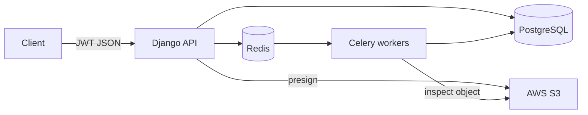
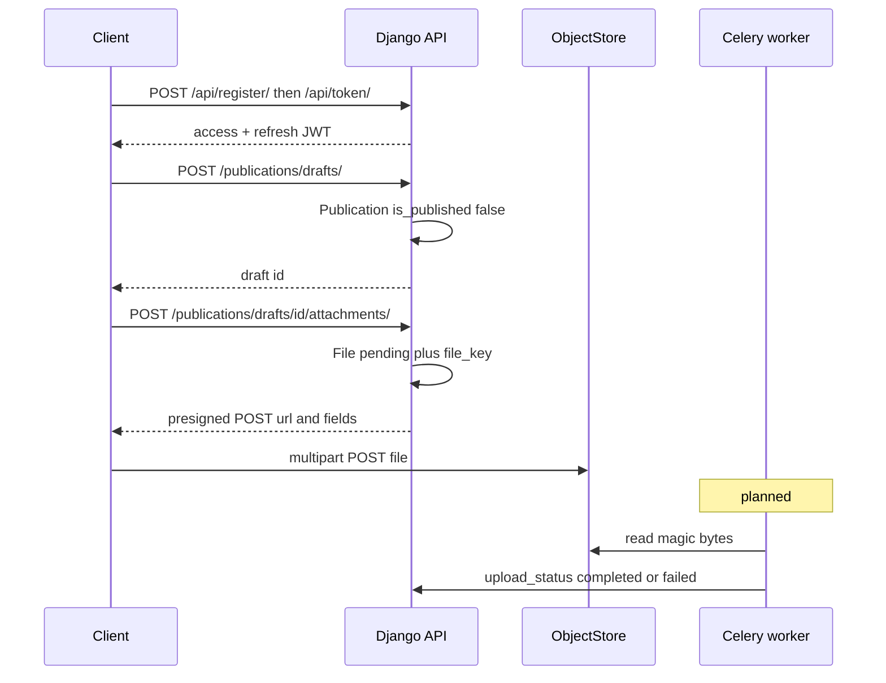
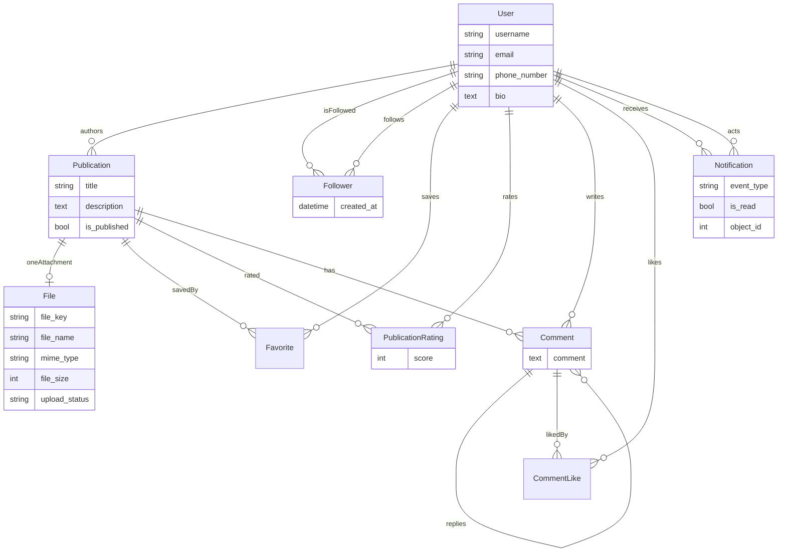

[English](README.md) | Русский

# ReadKoom

**Koom** по-кыргызски значит *сообщество*.

Backend API, через который студенты делятся учебными материалами — конспектами, слайдами, PDF, изображениями, аудио — вместо того чтобы сбрасывать всё в групповые чаты.

> **Статус:** В разработке: Авторизация, черновики и presigned-загрузка работают. Воркеры, проверка файлов, социальные API и Docker — в работе, проект не заброшен.

## Проблема

В университетах файлами до сих пор делятся через WhatsApp и Telegram: ссылки истекают, поиска и фильтрации нет, 

ReadKoom должен заменить эту кучу чатов небольшой социальной библиотекой. Файлы лежат в объектном хранилище (в облаке), а не в чьём-то телефоне. Регистрация и вход по JWT. Любой с аккаунтом может создать черновик и загрузить файл. Метаданные (название, описание, автор) позволяют потом найти материал. Подписки, избранное, комментарии и оценки — следующие шаги.

**Для кого:** студенты и преподаватели-ассистенты, которые и так живут в групповых чатах и хотят постоянное место для лекций и домашек.

## Статус и план

| Область | Состояние |
|---------|-----------|
| Свой пользователь, JWT (выдача / refresh / blacklist) | **Готово** |
| Регистрация (хеш пароля, валидаторы Django) | **Готово** |
| Черновики публикаций (CRUD, запись только автором) | **Готово** |
| Один файл на публикацию + presigned **upload** | **Готово** |
| Allowlist MIME по имени файла, лимит размера, короткий TTL URL | **Готово** |
| Хелпер presigned **download** | **Готово** (HTTP-маршрута ещё нет) |
| Модели follower / favorite / rating / comment / notification | **Готово** (только схема) |
| Проверка magic-byte (`python-magic`) | **В работе** (заглушка) |
| Celery + Redis (почта, задачи проверки) | **Запланировано** |
| Подтверждение email, асинхронное восстановление пароля | **Запланировано** |
| Лента опубликованного, API подписок | **Запланировано** |
| API скачивания, комментариев / оценок / избранного | **Запланировано** |
| Amazon S3 для объектного хранилища | **Готово** |
| Docker Compose, тесты, цифры нагрузки | **Запланировано** |
| Фронтенд | **Не начат** |

## Архитектура

**Целевая** (к чему система идёт):



**Сейчас в репозитории:** Django + PostgreSQL + boto3 к Amazon S3. Redis, Celery и Compose ещё не подключены. Цепочка загрузки ниже уже соответствует API; проверка воркером ещё впереди.

### Поток presigned-загрузки

Байты через API не идут. Django хранит метаданные и короткоживущую POST-политику; клиент кладёт объект сразу в бакет.



1. Авторизация (JWT).
2. Создать **черновик** публикации (неопубликованный родитель).
3. Прикрепить **один** файл: API создаёт `File` (`pending`) и возвращает `generate_presigned_post`.
4. Клиент загружает в бакет по ключу `publications/<user>/<uuid>`.
5. **План:** воркер читает magic bytes, сверяет заявленный тип с содержимым, ставит `completed` или `failed`.
6. **План:** скачивание — короткий GET URL только при статусе `completed`.

Политика загрузки сейчас: `content-length-range` 1…`MAX_UPLOAD_BYTES`, совпадение `Content-Type`, срок **900 с**. Хелпер скачивания — **1800 с**.

## Стек

| Слой | Выбор |
|------|--------|
| Язык | Python 3 |
| API | Django 6, Django REST Framework |
| Авторизация | JWT (`djangorestframework-simplejwt`) + blacklist |
| База | PostgreSQL |
| Объектное хранилище | Amazon S3 (`boto3`, `django-storages`) |
| Задачи (план) | Celery + Redis |
| Тип файла (план) | `python-magic` (libmagic) |
| Телефон | `django-phonenumber-field` |
| Конфиг | `.env.local` через `python-dotenv` |

## Решения и компромиссы

### Родитель Publication и один `File`

Это две сущности, потому что у них разные задачи. **Publication** — социальная запись: кто создал, `is_published`, название и описание. **File** — метаданные объекта: размер, тип и `upload_status`.

`FileField` на Publication не нужен: загрузка и скачивание идут через **presigned URL**, Django байты не хранит. **Одна публикация — одно вложение**, ради простоты.

### Потолок ~90 МБ, без multipart

Около **90 МБ** — практичный размер для **одного запроса**. API остаётся на одном presigned POST и не делает S3 multipart / нарезку.

В настройках пока `MAX_UPLOAD_BYTES = 100 * 1000 ** 2` (100 миллионов байт). Правило дизайна — «один запрос, около 90 МБ»; константа должна оставаться в этом диапазоне.

### Одна таблица `Notification`

Одной таблицы уведомлений достаточно. Колонка `event_type` говорит, что произошло (новый подписчик, оценка, комментарий и т.д.). Строка ссылается на связанный объект (`GenericForeignKey`), а не плодит таблицу на каждый тип события.

### Отдельная модель `PublicationRating`

Целое поле на `Publication` могло бы хранить среднее, но не **кто какую** публикацию оценил — автору нельзя было бы слать уведомление. Оценка — своя сущность; у неё другая задача, чем у публикации.

### Проверка типа файла (magic bytes)

Проверка — это **целостность типа**: браузер должен отрисовать то, что заявлено, и пользователь не должен залить другой тип, чем указал. Это **не** антивирус. Осмотр планируется по тому же ключу объекта (см. ограничения).

## Модель данных

**Publication** — социальный объект. **File** — дочерняя 1:1 запись ключа в хранилище и статуса загрузки. Остальное висит на пользователях и публикациях.



Типы событий в модели: новый подписчик, оценка публикации, комментарий к публикации, лайк комментария, публикация от подписки, комментарий от подписки.

## Модель безопасности и известные ограничения

### Зачем проверка

Когда появится задача magic-byte, она будет проверять **целостность типа**: содержимое совпадает с разрешённым MIME, браузер сможет открыть файл, байты совпадают с заявленным типом. Это allowlist, не продукт безопасности.

### Чего она не делает

- **Нет антивируса.** Валидный PDF всё равно может быть вредоносным.
- **Нет песочницы и модерации контента.**
- MIME по имени файла (сейчас) можно подделать, пока не заработает magic-byte.
- Нет обещания, что опубликованные файлы «безопасны».

### Разрыв verify-then-overwrite

Объект грузится на **финальный ключ**. Проверка (план) читает тот же ключ и меняет `upload_status`. **Нет** карантинного бакета и **нет** copy/promote на новый ключ после чистой проверки.

Вторая загрузка на тот же ключ — если у клиента ещё жив presigned POST или бакет разрешает overwrite — может подменить уже проверенный файл. API будет показывать `completed`, пока проверка не пройдёт снова.

**Смягчение сейчас:** короткий TTL (загрузка 15 мин, скачивание 30 мин), uuid-ключи, один `File` на публикацию, без публичного listing бакета. Это **сужает окно**, но не закрывает его.

### Прочие ограничения

- `DEBUG=True`, пустой `ALLOWED_HOSTS` — только локально.
- CORS ещё нет; браузерному клиенту он понадобится, плюс **CORS бакета** для POST/GET.
- Presigned URL — это capability: держите их в секрете до истечения.
- API подписок / уведомлений / комментариев / оценок не отдаются (include `users/` и `notifications/` пустые).
- Модели не зарегистрированы в Django admin.
- Автотестов пока нет.
- JWT-логин — **username + пароль**, не email.

### Разрешённые типы (allowlist по имени файла)

PNG, JPEG, WebP, GIF, PDF, TXT, CSV, DOCX, XLSX, PPTX, MPEG / WAV / OGG / MP4 audio.

## API (что можно вызвать сегодня)

База (dev): `http://127.0.0.1:8000/`  
Защищённые маршруты: `Authorization: Bearer <access>` (access **60 мин**, refresh **1 день**).

| Метод | Путь | Auth | Назначение |
|-------|------|------|------------|
| POST | `/api/register/` | нет | `first_name`, `last_name`, `username`, `email`, `password` |
| POST | `/api/token/` | нет | username + пароль → токены |
| POST | `/api/token/refresh/` | нет | новый access |
| POST | `/api/token/blacklist/` | нет | отозвать refresh |
| GET, POST | `/publications/drafts/` | да | список / создание черновиков |
| GET, PUT, PATCH, DELETE | `/publications/drafts/<id>/` | да | запись только автором |
| POST | `/publications/drafts/<id>/attachments/` | да | `file_name` → `File` + presigned POST |
| GET | `/admin/` | staff | Django admin |

Второе вложение к той же публикации → **409** (`Publication already has a file`).

### Примеры

```bash
curl -X POST http://127.0.0.1:8000/api/register/ \
  -H "Content-Type: application/json" \
  -d '{"first_name":"Aida","last_name":"K.","username":"aida","email":"aida@example.com","password":"choose-a-strong-password"}'

curl -X POST http://127.0.0.1:8000/api/token/ \
  -H "Content-Type: application/json" \
  -d '{"username":"aida","password":"choose-a-strong-password"}'

curl -X POST http://127.0.0.1:8000/publications/drafts/ \
  -H "Authorization: Bearer ACCESS" \
  -H "Content-Type: application/json" \
  -d '{"title":"Linear algebra notes","description":"Week 3"}'

curl -X POST http://127.0.0.1:8000/publications/drafts/1/attachments/ \
  -H "Authorization: Bearer ACCESS" \
  -H "Content-Type: application/json" \
  -d '{"file_name":"notes.pdf"}'
```

Дальше POST на возвращённые `url` + `fields` S3 и файл как `multipart/form-data`. API байты не видит.

## Запуск

Django читает **`.env.local`** (в gitignore).

### `.env.local`

```bash
# Django
SECRET_KEY=change-me

# PostgreSQL
DB_NAME=readkoom
DB_USER=readkoom
DB_PASSWORD=change-me
DB_HOST=localhost
DB_PORT=5432
```

### Локальный venv

Нужны Python 3, PostgreSQL и учётные данные S3.

```bash
python -m venv venv
source venv/bin/activate
pip install -r requirements.txt
# заполните .env.local переменными выше
python manage.py migrate
python manage.py createsuperuser   # по желанию
python manage.py runserver
```

Команды **seed пока нет**. Пользователя создайте через `/api/register/` или admin.

Системный пакет позже: `libmagic` (`libmagic1` на Debian/Ubuntu) для `python-magic`.

API: `http://127.0.0.1:8000/`

## Тесты

```bash
python manage.py test
```

**Покрытие сейчас:** нет. `tests.py` в приложениях — заглушки Django.

**План:** API-тесты на регистрацию/JWT, авторство черновика, 409 на второй файл, отказ MIME, форму presign; затем тесты воркера на pass/fail magic-byte.

**Нагрузочные тесты:** не гонялись. Сюда нужны **живые цифры** (p50/p95 latency, доля успешных загрузок, лаг воркера) после k6/Locust — не оценки.

## Демо

Ещё нет. Сюда: короткий GIF черновик → presign → S3 PUT, скриншоты ответов API или живой URL.

## Лицензия

TBD. Все права защищены, пока лицензия не выбрана.

## Контакты

TBD — имя, email, LinkedIn / GitHub.

---

ReadKoom = **Read** + **Koom** (сообщество).
